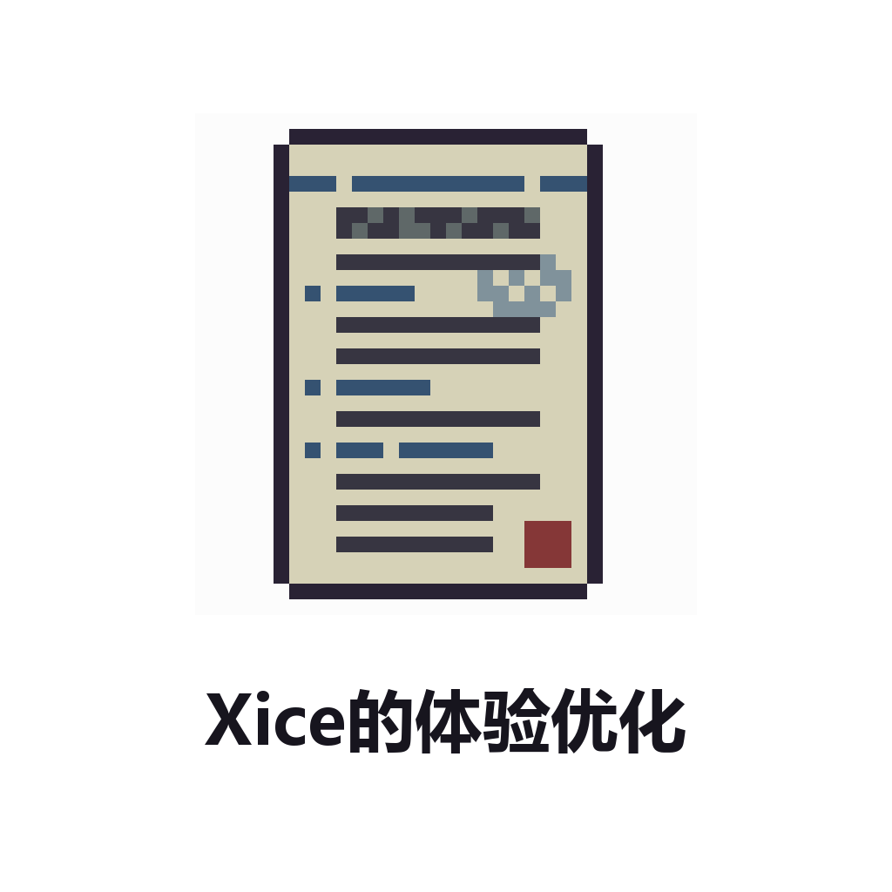
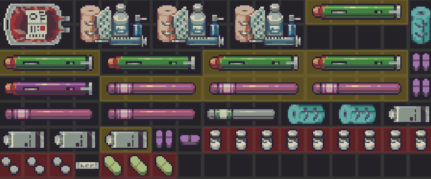
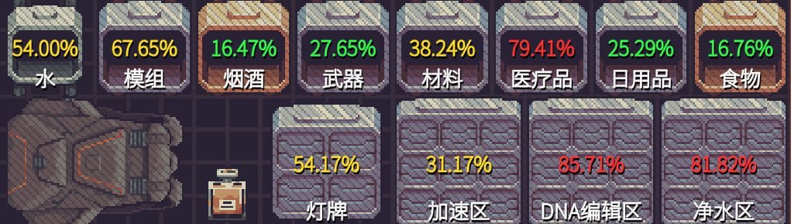
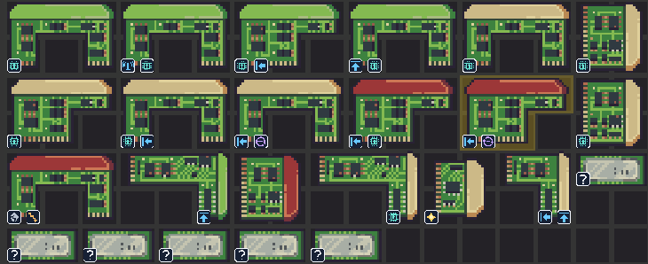

# 展示页发布版本

**用户已确认发布此版本。**

## 标题

Xice的体验优化

## 封面

保留白色背景与 1024 × 1024 分辨率；主体为原版单页指南文档物品图标 `guide1`，主标题为“Xice的体验优化”，无副标题。

## 展示图片

以下三张原图按提供顺序展示，不添加配文。

---

以下为发布介绍正文：

个人制作使用的体验优化mod，对部分信息显示和操作进行了优化。所有功能均可通过配置项调整。

## 模组功能
- **物品信息显示**：不同颜色背景高亮标记赃物和违禁品；物品左上角显示箭头提示市场涨跌；机器上展示缺电、容量不足等信息图标。
- **储藏区信息优化**：在储藏区图标上显示自定义名称与容量占用比例。
- **自动开关指南**：执行检查、鉴定时，自动打开拥有的对应指南。
- **操作优化**：地下交易收获自动摆到柜台，回执与情报纸条自动丢进垃圾桶；夜间服务补充防盗率、清洁风险等警告信息。
- **少量自动化功能**：为部分物品和改造体的检定提供自动化功能，以允许在某些条件下自动完成对应的检查。

## 使用与设置
订阅后，在 Mod 菜单中启用模组，并按提示重启游戏。

配置分为**通常、图标、自动化**三个标签页，按需修改后点击**应用**保存。

**自动化页的功能默认全部关闭。**

## 注意事项
- 当前支持游戏内部版本**0.46D**，游戏更新后请留意兼容性说明。

## 反馈与源码
如遇问题，欢迎提供游戏版本、相关设置、复现步骤，以及截图或日志。
[问题反馈](https://github.com/xice-1201/XicesBetterExperience/issues) · [GitHub 源码](https://github.com/xice-1201/XicesBetterExperience)
